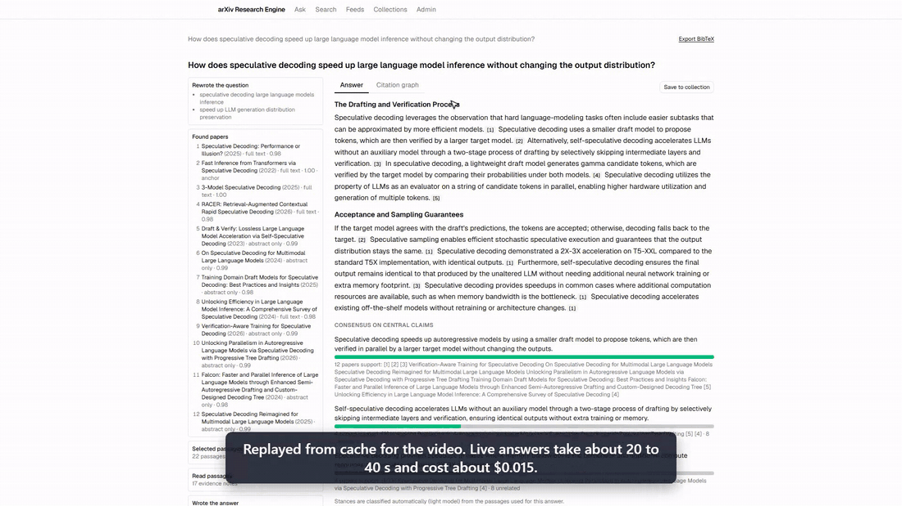
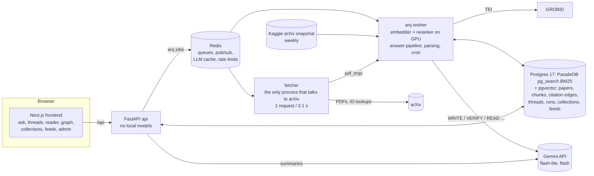
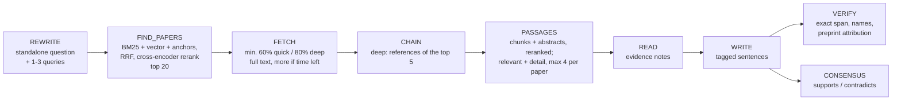

# arXiv Research Engine

A local research tool for arXiv computer science and mathematics papers (the last 5 years, plus landmark and
foundational papers). Ask a question; it finds the relevant papers, reads them, and writes an answer in which every
sentence cites the exact passage it came from. A verifier checks each sentence against its sources and removes or
rewrites what they do not support.



**Demo video (2.5 min):** [demo/demo.mp4](demo/demo.mp4): quick answer with the live trace, citation passages, the
reader, the citation graph, full text on demand, deep mode, a mathematics question, and BibTeX export.

## What it does

- **Answers with checked citations.** An answer draws on up to 20 papers and at most 4 passages from each, keeping
  only the passages relevant to the question plus a little more detail from the same papers. Full text first: at
  least 60% (quick) or 80% (deep) of the selected papers must have full text before the answer is written, even if
  that takes longer than the mode's time limit (3 min quick, 6 min deep); with the minimum reached, fetching goes on
  while time is left. Deep mode also follows references. Papers still without full text contribute their abstract. Each sentence carries `[n]` chips: hover
  shows the passage, click opens the reader at that passage.
- **Verification.** For every sentence the verifier must copy an exact supporting span from a cited source (checked
  in code); named methods, datasets, and authors must appear in the cited source; strong claims (proofs, "first",
  state of the art, resolving open problems) from preprints must be attributed ("a 2022 preprint by X claims ...").
  Unsupported sentences are removed and counted.
- **Threads.** Follow-ups keep context; citation numbers stay stable within a thread; papers can be pinned; "Ask about
  this paper" limits a thread to one paper and the papers it cites.
- **Exploration.** Paper pages with a structured summary, a reader of the parsed full text, references, cited-by,
  and a citation graph; consensus bars (which papers support or contradict the central claims); collections with
  BibTeX export; feeds with weekly digests of new papers.
- **Citations are our own.** No external citation API: citation edges come from the bibliographies of papers whose
  full text has been parsed here, so "cited by N" means "cited by N full-text papers in this corpus".

## Architecture



**Answer pipeline** (fixed sequence, no agent loop; every step is saved and streamed over SSE):



Retrieval: per query, BM25 keyword search (ParadeDB `pg_search`: stemmed title and abstract, title boosted, any
query term, IDF-weighted; filters applied inside the index) and HNSW vector search over abstracts
(`BAAI/bge-small-en-v1.5`, halfvec), fused with reciprocal rank fusion, plus an anchor channel over landmark and
foundational papers (vector + BM25 title match); candidates are reranked with `BAAI/bge-reranker-v2-m3`, combined with
a citation/metadata prior, and filtered by a minimum score; the top 20 are selected. Passages come from the chunks of
full-text papers the same way (BM25 + vector within the selected papers); abstract-only papers contribute their
abstract. Of the reranked passages, those scoring at least `agent.passage_min_score` are kept (at most 4 per paper,
40 in all), plus up to 10 weaker ones from papers that already have a relevant passage. The old Postgres
full-text keyword channel is still available (`retrieval.keyword_engine: fts`) for comparison.

Full text on demand: the fetcher downloads a PDF, GROBID parses it to TEI (PyMuPDF as fallback), the worker chunks
(~350 tokens, section-aware), embeds, marks the paper ready, then resolves its bibliography into citation edges
(arXiv id, exact title, trigram title match against the corpus and the full arXiv catalog). PDFs are deleted after
parsing; the TEI is kept.

## Setup

Requirements: Docker Desktop (WSL2 on Windows) with NVIDIA GPU support, GNU make, disk space for `DATA_DIR`,
and 10 GB of memory for the Docker VM (on Windows: `.wslconfig` with `memory=10GB`, `swap=4GB`).

```bash
cp .env.example .env        # GEMINI_API_KEY, Kaggle credentials, CONTACT_EMAIL, POSTGRES_PASSWORD, DATA_DIR
make up                     # build, start infra, run migrations, start everything
make status                 # health of every service
make ingest-metadata        # Kaggle arXiv snapshot -> tier 1 papers (~820k), metadata scores
make embed                  # abstract embeddings (GPU, ~2.5 h the first time)
make landmarks              # queue full text for the ~100 landmark papers
```

- Frontend: http://localhost:3000 (press `/` to focus the ask box)
- API: http://localhost:8000 (`/docs` for the OpenAPI page)

All settings live in [config.yaml](config.yaml) (models, retrieval parameters, timeouts, rate limits, prices).
Secrets are read only from environment variables (`.env`, never committed).

## Operations

| command | what it does |
|---|---|
| `make warm TOPIC="..."` | queue full text for the top papers on a topic |
| `make fetch IDS="2106.09685 ..."` | queue specific papers |
| `make fulltext-report` | fetch/parse timings, chunks, reference resolution rate |
| `make score` | PageRank and scores from the current citation edges |
| `make snapshot` | run the weekly job now: latest Kaggle snapshot, new and changed papers only, then foundational papers, embeddings, scores |
| `make nightly` | nightly OAI-PMH harvest; disabled (`jobs.oai_harvest_enabled: false`), see below |
| `make eval ARGS="..."` | eval suite (below) |
| `make eval-verifier` | adversarial verifier test |
| `make backup` / `make restore FILE=...` | `pg_dump` custom format to `DATA_DIR/backups/` |
| `make test` / `make lint` | pytest; ruff + mypy |

Scheduled in the worker (UTC): janitor every 30 min, weekly Kaggle snapshot Mondays at 00:30, feed digests Mondays
at 03:00.

**New papers.** The weekly job downloads the latest Kaggle arXiv snapshot (skipped when the local copy is current),
processes only records whose `update_date` is on or after the newest one already ingested, upserts them through the
same metadata pass as the initial load, and then runs the post-ingest steps (foundational papers, abstract
embeddings, citation scores, PageRank). A nightly OAI-PMH harvest is implemented but disabled: arXiv's OAI
endpoint answers `ListRecords` with HTTP 406 (other verbs work), so papers newer than the latest snapshot appear with
up to a week's delay.

**Gemini free tier.** The key runs on the free tier: gemini-3.5-flash allows 20 requests per day, so WRITE uses
gemini-3.5-flash-lite by default (`models.write_model`; flash is selectable). A shared per-model rate limiter keeps
requests under the per-minute limits; if the main model returns 503 twice or its daily quota is used up, that call
falls back to flash-lite and the answer shows which model wrote it. Responses are cached in Redis for 30 days.

## Eval

`eval/questions.yaml` has 40 questions (30 quick, 10 deep) with the papers a good answer should find; every expected
paper was checked to be in the corpus. `make eval` runs retrieval for all of them with no LLM calls (the question is
the only query) and reports recall@10, MRR, passage hit@10, and latency; ablations switch off channels or change the
embedding model or chunk size. `make eval ARGS=--answers` runs the full answer pipeline through the API and adds run
latency, cost, removed-claims rate, and a CSV sample of (sentence, cited passage) pairs for manual precision checks.

```bash
make eval                                              # retrieval, baseline
make eval ARGS="--ablations baseline,no-keyword,no-vector,no-rerank"
make eval ARGS="--chunk-size 200"                      # re-chunks full-text papers into eval_cs200
make eval ARGS="--embedding BAAI/bge-base-en-v1.5"     # builds eval_emb_* once (hours)
make eval ARGS="--answers"                             # answer pipeline, cached LLM responses
make eval ARGS="--ablations baseline,fts"              # BM25 vs the old Postgres FTS keyword channel
```

### Results: BM25, 20 papers, fetch targets (2026-10-05)

Rebuilt corpus (Kaggle snapshot of 2026-10, 828,181 papers; at the retrieval eval only the 103 landmark papers had
full text), so these numbers are not comparable with the 2026-10-01 results below, which had thousands of full-text
papers. Same 40 questions; retrieval uses the question as the only query.

| variant | recall@10 | MRR | passage hit@10 | latency p50 | latency p95 |
|---|---|---|---|---|---|
| **production: BM25** (all words, no gate) | **0.637** | **0.567** | **0.750** | 2.0 s | 2.6 s |
| old keyword channel (FTS, AND, generic words dropped, gated) | 0.613 | 0.565 | 0.725 | 1.7 s | 2.1 s |
| BM25 + generic words dropped + gate (the FTS fixes) | 0.613 | 0.531 | 0.725 | 2.3 s | 3.2 s |
| BM25 + gate | 0.637 | 0.566 | 0.725 | 1.6 s | 2.4 s |
| no keyword | 0.613 | 0.573 | 0.725 | 1.5 s | 1.8 s |
| no vector | 0.588 | 0.554 | 0.725 | 1.4 s | 2.1 s |
| no rerank | 0.512 | 0.392 | 0.675 | 0.3 s | 0.4 s |

BM25 finds one more expected paper and one more expected passage than the old channel; MRR is equal. The two fixes
the AND query needed (dropping generic question words, keeping only keyword hits the vector channel also ranks in
its top 200) hurt BM25, whose IDF already discounts common words, so both are off (`retrieval.keyword_drop_generic`,
`retrieval.keyword_gate_k`). With 40 questions, a difference of 0.025 recall is one question: BM25 is at least as
good, not clearly better; the keyword channel still adds little over vector search plus the reranker.

**Answers** (all 40 questions, live, the same day):

| | quick (30) | deep (10) |
|---|---|---|
| latency p50 / p95 | 66 s / 147 s | 104 s / 215 s |
| timed out | 0 | 0 |
| fetch goal reached (60% / 80% of 20 papers with full text) | 27 of 30 | 10 of 10 |

| cost per answer | claims removed by the verifier | writer fallbacks | selected papers: recall@10 | Gemini requests per answer |
|---|---|---|---|---|
| $0.023 | 11.2% | 0 | 0.637 | ~7.3 |

Passages per answer: 37.7 on average (cap 40), nearly all above `passage_min_score`. The three quick runs that missed
the 60% goal reached 7, 11, and 11 of 12 papers within the 120 s fetch wait. Causes found and fixed afterwards: spare
fetches of the previous run kept their place in the urgent queue (now moved to the bulk queue when a run stops
waiting); PyMuPDF-parsed papers whose TEI held XML-invalid characters never finished (now sanitized); and the weekly
snapshot cron job, which ran inside the worker and blocked it for 5 minutes on Monday 00:30 UTC (now a child
process, with its 8 h timeout). Then 12 more answers on topics with no full text yet, back to back: 8 with the queue
fix, of which 5 reached the goal (two misses overlapped the old cron job, one reached 11 of 12 right after a worker
restart), and 4 with the cron fix while the weekly job ran next to them, all of which reached it (36-67 s of fetching).

These runs used a fixed fetch wait (120 s quick, 240 s deep) that could end below the minimum. FETCH now works in two
phases: the minimum is mandatory, even past the time limit (only a safety stop, `fetch_max_wait_quick_s` 300 s /
`fetch_max_wait_deep_s` 480 s, for an arXiv or GROBID outage, or running out of fetchable papers ends it early); with
the minimum reached, it keeps fetching the remaining papers until the time limit minus `answer_reserve_*_s` (70 s / 100
s, the measured p95 of the steps after FETCH). Live checks on new topics: quick reached its 12 papers after 66 s and
all 20 after 94 s (answer in 121 s); deep reached 16 after 163 s and all 20 after 242 s (266 s); with the quick time
limit set to 30 s for a test, FETCH still went on to 12 of 20 (165 s), then READ and CONSENSUS were skipped and the
run ended `timed_out` with a verified answer.

**Answers with the two-phase FETCH** (all 40 questions again, 2026-10-05):

| | quick (30) | deep (10) |
|---|---|---|
| latency p50 / p95 | 127 s / 135 s | 278 s / 302 s |
| timed out | 0 | 0 |
| minimum reached (60% / 80% of 20 papers with full text) | 30 of 30 | 10 of 10 |
| papers with full text at the end (average / lowest) | 75% / 65% | 94.5% / 90% |

| cost per answer | claims removed by the verifier | writer fallbacks | selected papers: recall@10 |
|---|---|---|---|
| $0.021 | 13.3% | 0 | 0.637 |

These questions had been asked the day before, so on average 14 (quick) and 18 (deep) of their 20 papers already
had full text and the minimum held from the start; this run measures the extra fetching (answers now use their time
budget: ~127 s of the 180 s quick limit, ~278 s of 360 s deep). The live checks above cover fetching the minimum from
scratch. READ was retried for too few notes in 3 of 40 runs. With the corpus grown to ~900 full-text papers and
PageRank recomputed by the weekly job, the retrieval baseline the same morning was recall@10 0.637, MRR 0.607, passage
hit@10 0.750 (0.567 MRR the day before).

### Earlier results (2026-10-01, previous corpus)

Eval of 2026-10-01, 40 questions (32 cs, 8 math; 30 quick, 10 deep). Retrieval uses the question as the only query
(no LLM rewrite), so these numbers are retrieval alone.

| variant | recall@10 | MRR | passage hit@10 | latency p50 | latency p95 |
|---|---|---|---|---|---|
| **production** (keyword + vector + anchors, reranked) | **0.637** | **0.605** | **0.725** | 1.9-2.3 s | 2.6-3.5 s |
| no keyword | 0.613 | 0.582 | 0.700 | 1.8 s | 2.3 s |
| no vector | 0.525 | 0.533 | 0.325 | 0.3 s | 1.3 s |
| no rerank | 0.562 | 0.472 | 0.625 | 0.1 s | 0.2 s |

Recall@10 / MRR by question tag (production): landmark paper expected 0.70 / 0.70 (23 questions) vs not 0.56 / 0.47
(17); named in the question 0.70 / 0.62 (27) vs described only 0.50 / 0.58 (13); cs 0.70 / 0.70 (32) vs math
0.38 / 0.23 (8); quick 0.68 / 0.62 (30) vs deep 0.50 / 0.56 (10). The vector channel matters most for questions
without a landmark paper (0.26 recall without it); the reranker is the largest contributor to MRR.

**Keyword channel fix.** The first full eval had the keyword channel slightly hurting recall (0.588 with it, 0.613
without). Its query ANDs every question word, so generic words ("new", "reduce", "replace", "cost") limited it to a few
later papers that paraphrase the question, which then crowded out the original paper (e.g. "Attention Is All You
Need"). Tested on all 40 questions:

| keyword variant | recall@10 | MRR | passage hit@10 | p50 | p95 |
|---|---|---|---|---|---|
| all words (before) | 0.588 | 0.577 | 0.650 | 2.4 s | 3.8 s |
| generic question words removed | 0.613 | 0.602 | 0.675 | 1.6 s | 2.5 s |
| hits kept only if in the vector channel's top 200 | 0.613 | 0.581 | 0.700 | 1.7 s | 2.3 s |
| both (adopted) | 0.637 | 0.605 | 0.725 | 1.6 s | 2.2 s |
| any word, ranked by overlap | 0.613 | 0.573 | 0.700 | 13.6 s | 25.0 s |

Both changes together fix two questions (Transformer, Self-RAG) with no regressions on the other 38 and no latency
cost (the gate reuses the vector query, which now fetches 200 instead of 100). Settings:
`retrieval.keyword_drop_generic`, `retrieval.keyword_gate_k`.

**Answers** (all 40 questions through the full pipeline, including the LLM rewrite, on the production configuration;
answers written by gemini-3.5-flash-lite):

| | quick (30) | deep (10) |
|---|---|---|
| latency p50 / p95 | 24 s / 43 s | 54 s / 103 s |
| timed out | 0 | 0 |

| cost per answer | claims removed by the verifier | writer fallbacks | selected papers: recall@10 | answers citing an expected paper |
|---|---|---|---|---|
| $0.014 | 48 of 383 sentences (12.5%) | 0 | 0.600 | 28 of 40 |

Removed claims by reason: no exact supporting span 26, no source tag 8, rewrite failed its re-check 6, named term not
in the source 3, malformed source tag 3, unsupported 2.

Tag repair: the writer sometimes cites an abstract with a chunk-style tag (`[[c:2604.00479]]` for `[[a:2604.00479]]`).
Such tags are now mapped to the abstract when it is among the passages, and the sentence still goes through the
verifier. Before the repair: 54 of 379 sentences removed (14.2%), 8 of them for malformed tags; after: 48 of 383
(12.5%), 3 malformed tags left (garbled ids, not repairable). 5 tags were repaired in the 40 answers.

**Citation precision** (95 random (sentence, cited passage) pairs, checked by hand): 90 fully supported and correctly
attributed; 1 wrong (it reverses which paper generalizes which); 4 imprecise (2 add a detail the passage does not
contain, 2 garble the attribution). The claim itself is supported in 92 of 95 (96.8%); strict precision 90 of 95
(94.7%). Three sentences still mention a source's status ("a peer-reviewed paper by ...") despite the prompt rule,
and some background statements are hedged as a preprint's claim when they need no attribution.

Other measured results: the adversarial verifier test catches 11 of 12 altered sentences
(wrong numbers, wrong paper, merged experiments, unsupported extensions, preprint claims stated as fact) with at most
1 of 12 originals wrongly removed; the reranker switch to bge-reranker-v2-m3 moved the paper a question is about to
rank 1 in the A/B set.

## Known limitations

- **Math is not compared exactly.** The verifier checks that a supporting span exists and that rewrites keep their
  `$...$` math, but it does not compare formulas in a sentence with the source: full-text passages come from PDFs
  as plain text without LaTeX. A wrong exponent can pass (seen: "|F| > ck^4 m" for a source's (ck^4)^m).
- **Claims combining two sources can slip through.** Each sentence is checked against the passages it cites, as a
  whole; a sentence that merges a fact from one source with a detail from another ("65B on a consumer GPU" from
  "33B on a consumer GPU" and "65B on a 48 GB GPU") is sometimes accepted (missed in every run of the adversarial
  test).
- **Preprint detection depends on arXiv metadata.** A paper counts as peer-reviewed only if its journal-ref or
  comments name a venue; many published papers never update that, so they are treated as preprints and their strong
  claims get attributed ("a 2023 preprint by ... reports"). Landmark and foundational papers are never treated as
  preprints. The verifier also sometimes hedges background statements that need no attribution.
- **Free-tier Gemini.** gemini-3.5-flash allows 20 requests a day and flash-lite 500, so answers are written by
  flash-lite, and a model's 503/429 falls back to flash-lite (shown on the answer). An answer takes ~7 flash-lite
  requests; a hard cap of 450 a day (`llm_client.daily_caps`, counted across the app and the eval scripts) leaves
  room for about 60 answers a day. Cached answers cost nothing.
- **Answers wait for full text.** At least 60% (quick) or 80% (deep) of the 20 selected papers get full text
  before the answer is written, even past the time limit, and fetching continues while time is left, so answers use
  most of their time budget (about 2-3 min quick, 4-6 min deep on new topics). arXiv allows one request every 3.1 s
  and GROBID parses 2 PDFs at a time, and concurrent users share one fetch queue, so a busy queue can push the
  mandatory part past the limit. Papers still pending when FETCH ends keep downloading in the background.
- **Citation precision was not re-checked by hand** for the BM25 / 20-paper configuration; the sample to check is in
  `eval/results/citation_sample_20261004T230801Z.csv` (local; `eval/results/` is not committed).
- **Writer tagging errors.** flash-lite sometimes leaves a sentence untagged or garbles a source id; such sentences
  are removed even when the claim is right (11 of the 48 removals in the eval). Chunk-style tags for an abstract are
  repaired.
- **Reranker saturation.** On a popular topic the cross-encoder gives dozens of newer papers that discuss the topic
  scores of ~0.99, the same as or above the paper the question is about, and the citation prior adds only ~0.01-0.05,
  so the original drops out of the top 10 even though it is among the candidates. Examples: "How does grouped-query
  attention reduce the memory cost of decoding?" (the GQA paper is a candidate at fused rank 7; "Grouped Value
  Attention", "GTA" and other 2025-26 papers score 0.92-0.998 above it) and "What are the new upper bounds for
  diagonal Ramsey numbers?" (the 2023 breakthrough is a candidate at fused rank 15; papers on multicolor, poset and
  small Ramsey numbers score 0.97-0.995). Not tuned for: a fix would trade recall on originals against recent work.
  Math recall is lower overall (0.38 recall@10 on 8 questions).
- **New papers arrive weekly**, from the Kaggle snapshot; arXiv's OAI-PMH `ListRecords` returns HTTP 406, so the
  nightly harvest is disabled.
- **Citation counts are within this corpus** (edges come only from papers whose full text was parsed here).

## Layout

```
backend/   FastAPI app, arq worker, fetcher, ingestion, retrieval, answer pipeline, tests
frontend/  Next.js app (App Router, Tailwind, shadcn/ui)
eval/      questions, eval runner, verifier and model comparisons, results/
demo/      demo video and GIF
seeds/     landmark papers (validated against the Kaggle metadata at load time)
```
