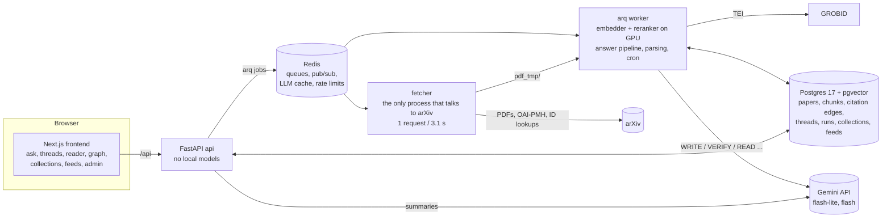
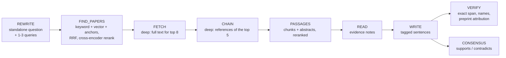

# arXiv Research Engine

A local research tool for arXiv computer science and mathematics papers (the last 5 years, plus landmark and
foundational papers). Ask a question; it finds the relevant papers, reads them, and writes an answer in which every
sentence cites the exact passage it came from. A verifier checks each sentence against its sources and removes or
rewrites what they do not support.

> Demo video: _placeholder_

The build log, decisions, and measurements for every milestone are in [PROGRESS.md](PROGRESS.md); the full spec is
[MASTER_PROMPT.md](MASTER_PROMPT.md).

## What it does

- **Answers with checked citations.** Quick mode answers from abstracts and cached full text in ~20-30 s; deep mode
  also fetches full text for the top papers (up to 8), follows their references, and takes 1-3 min. Each sentence
  carries `[n]` chips: hover shows the passage, click opens the reader at that passage.
- **Verification.** For every sentence the verifier must copy an exact supporting span from a cited source (checked
  in code); named methods, datasets, and authors must appear in the cited source; strong claims (proofs, "first",
  state of the art, resolving open problems) from preprints must be attributed ("a 2022 preprint by X claims ...").
  Unsupported sentences are removed and counted.
- **Threads.** Follow-ups keep context; citation numbers stay stable within a thread; papers can be pinned; "Ask about
  this paper" limits a thread to one paper and the papers it cites.
- **Exploration.** Paper pages with a structured summary, a reader of the parsed full text, references, cited-by,
  and a citation graph; consensus bars (which papers support or contradict the central claims); collections with
  BibTeX export; feeds with weekly digests of new papers.
- **Citations are our own.** No external citation API: citation edges come from the bibliographies of papers whose
  full text has been parsed here, so "cited by N" means "cited by N full-text papers in this corpus".

## Architecture



**Answer pipeline** (fixed sequence, no agent loop; every step is saved and streamed over SSE):



Retrieval (spec section 11): per query, Postgres full-text search and HNSW vector search over abstracts
(`BAAI/bge-small-en-v1.5`, halfvec), fused with reciprocal rank fusion, plus an anchor channel over landmark and
foundational papers; candidates are reranked with `BAAI/bge-reranker-v2-m3`, combined with a citation/metadata prior,
and filtered by a minimum score. Passages come from the chunks of full-text papers the same way; abstract-only papers
contribute their abstract.

Full text on demand: the fetcher downloads a PDF, GROBID parses it to TEI (PyMuPDF as fallback), the worker chunks
(~350 tokens, section-aware), embeds, marks the paper ready, then resolves its bibliography into citation edges
(arXiv id, exact title, trigram title match against the corpus and the full arXiv catalog). PDFs are deleted after
parsing; the TEI is kept.

## Setup

Requirements: Docker Desktop (WSL2 on Windows) with NVIDIA GPU support, GNU make, disk space for `DATA_DIR`,
and 10 GB of memory for the Docker VM (on Windows: `.wslconfig` with `memory=10GB`, `swap=4GB`).

```bash
cp .env.example .env        # GEMINI_API_KEY, Kaggle credentials, CONTACT_EMAIL, POSTGRES_PASSWORD, DATA_DIR
make up                     # build, start infra, run migrations, start everything
make status                 # health of every service
make ingest-metadata        # Kaggle arXiv snapshot -> tier 1 papers (~820k), metadata scores
make embed                  # abstract embeddings (GPU, ~2.5 h the first time)
make landmarks              # queue full text for the ~100 landmark papers
```

- Frontend: http://localhost:3000 (press `/` to focus the ask box)
- API: http://localhost:8000 (`/docs` for the OpenAPI page)

All settings live in [config.yaml](config.yaml) (models, retrieval parameters, timeouts, rate limits, prices).
Secrets are read only from environment variables (`.env`, never committed).

## Operations

| command | what it does |
|---|---|
| `make warm TOPIC="..."` | queue full text for the top papers on a topic |
| `make fetch IDS="2106.09685 ..."` | queue specific papers |
| `make fulltext-report` | fetch/parse timings, chunks, reference resolution rate |
| `make score` | PageRank and scores from the current citation edges |
| `make nightly` | run the nightly job now: OAI-PMH harvest (cs, math), foundational papers, embeddings, scores |
| `make eval ARGS="..."` | eval suite (below) |
| `make eval-verifier` | adversarial verifier test |
| `make backup` / `make restore FILE=...` | `pg_dump` custom format to `DATA_DIR/backups/` |
| `make test` / `make lint` | pytest; ruff + mypy |

Scheduled in the worker (UTC): janitor every 30 min, nightly job at 02:00, feed digests Mondays at 03:00.

**Gemini free tier.** The key runs on the free tier: gemini-3.5-flash allows 20 requests per day, so WRITE uses
gemini-3.5-flash-lite by default (`models.write_model`; flash is selectable). A shared per-model rate limiter keeps
requests under the per-minute limits; if the main model returns 503 twice or its daily quota is used up, that call
falls back to flash-lite and the answer shows which model wrote it. Responses are cached in Redis for 30 days.

## Eval

`eval/questions.yaml` has 40 questions (30 quick, 10 deep) with the papers a good answer should find; every expected
paper was checked to be in the corpus. `make eval` runs retrieval for all of them with no LLM calls (the question is
the only query) and reports recall@10, MRR, passage hit@10, and latency; ablations switch off channels or change the
embedding model or chunk size. `make eval ARGS=--answers` runs the full answer pipeline through the API and adds run
latency, cost, removed-claims rate, and a CSV sample of (sentence, cited passage) pairs for manual precision checks.

```bash
make eval                                              # retrieval, baseline
make eval ARGS="--ablations baseline,no-keyword,no-vector,no-rerank"
make eval ARGS="--chunk-size 200"                      # re-chunks full-text papers into eval_cs200
make eval ARGS="--embedding BAAI/bge-base-en-v1.5"     # builds eval_emb_* once (hours)
make eval ARGS="--answers"                             # answer pipeline, cached LLM responses
```

### Results

_To be filled in after the full eval run (pending approval of the question list)._

| variant | recall@10 | MRR | passage hit@10 | latency p50 | latency p95 |
|---|---|---|---|---|---|
| baseline | | | | | |
| no keyword | | | | | |
| no vector | | | | | |
| no rerank | | | | | |

| answers | quick p50 / p95 | deep p50 / p95 | cost per answer | removed claims | citation precision (manual sample) |
|---|---|---|---|---|---|
| 40 | | | | | |

Other measured results (details in PROGRESS.md): the adversarial verifier test catches 11 of 12 altered sentences
(wrong numbers, wrong paper, merged experiments, unsupported extensions, preprint claims stated as fact) with at most
1 of 12 originals wrongly removed; the reranker switch to bge-reranker-v2-m3 moved the paper a question is about to
rank 1 in the A/B set.

## Layout

```
backend/   FastAPI app, arq worker, fetcher, ingestion, retrieval, answer pipeline, tests
frontend/  Next.js app (App Router, Tailwind, shadcn/ui)
eval/      questions, eval runner, verifier and model comparisons, results/
seeds/     landmark papers (validated against the Kaggle metadata at load time)
```
